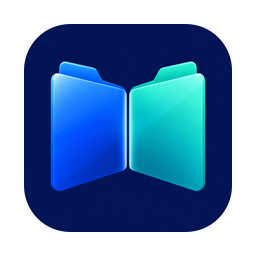

<div align="center">



# Commander4Mac

**A native, two-pane file manager for macOS.**

Tabs, pinned folders, a shared shelf and direct server connections, with your files side by side.

[Download for Mac](https://github.com/AlanHuang99/Commander4Mac/releases/latest) · [Report an issue](https://github.com/AlanHuang99/Commander4Mac/issues) · [Development guide](docs/DEVELOPMENT.md)

[](https://github.com/AlanHuang99/Commander4Mac/actions/workflows/ci.yml)
[](https://github.com/AlanHuang99/Commander4Mac/actions/workflows/release.yml)
[](https://github.com/AlanHuang99/Commander4Mac/releases/latest)
[](LICENSE)


</div>

## Your workspace, side by side

- **Two independent panes:** tabs, folder history, list and icon views, sorting and filtering.
- **Two kinds of pins:** lock a tab to its folder, or browse within a pinned tab and return to its saved path.
- **Favorites and shelf:** open favorites in the current, left or right pane; collect references before transferring them.
- **Local file operations:** queued copy and move, conflict choices, cancellation, new folders, rename and macOS Trash. Local copies preserve file metadata.
- **Mac integration:** Quick Look, Open With, clipboard file actions and restored workspaces.
- **Your preferred appearance:** System, Light or Dark, plus text and icon sizes.
- **Direct server access:** SFTP, SMB and HTTPS WebDAV, with saved secrets in Keychain and explicit SSH host-key verification.
- **Folder transfers:** copy files and directory trees between local and remote panes, with Skip, Keep Both or Cancel when a destination already exists.

Inspired by the efficiency of dual-pane file managers, with an original macOS interface.

## Install

Requires **macOS 15 or later**. The DMG contains a universal app for Apple Silicon and Intel Macs.

1. Download `Commander4Mac-1.0.dmg` from [Releases](https://github.com/AlanHuang99/Commander4Mac/releases/latest).
2. Open the DMG and drag **Commander4Mac** onto **Applications**.
3. Eject the disk image, then open **Commander4Mac** from Applications.
4. In **System Settings → Privacy & Security → Full Disk Access**, add `/Applications/Commander4Mac.app` and enable it. Restart the app if macOS requests it.
5. Allow **Local Network** access when connecting to a file server on your network.

Release automation signs with Developer ID, notarizes and staples both the app and DMG, then validates the packaged app before publishing. Each release includes a SHA-256 checksum. Full Disk Access is a macOS permission that you grant locally; it is separate from the app's setup acknowledgement.

For later versions, download the latest DMG and replace the app in Applications after transfers finish.

## Connect to a server

Press **⌘K**, choose a protocol, enter the endpoint and open it in either pane.

| Protocol | Connection details |
| --- | --- |
| SFTP | Password or OpenSSH Ed25519 key; verify the server's host fingerprint before trusting it. |
| SMB | Server and share, optional domain, password or Guest access. No system mount is required. |
| WebDAV | HTTPS endpoint and base collection, Basic/Digest or Anonymous authentication. Use the final endpoint URL because redirects are refused. |

Remote copies preserve contents and directory structure. They currently do not preserve remote permissions, timestamps, ACLs, extended attributes or resource forks. Existing destination trees are not merged or replaced. Remote move/Trash, server-to-server transfers, symlinks and packages are not supported. See the [network acceptance record](docs/verification/network-folders-release.md) for tested coverage and limits.

If a local server connection fails despite an enabled Local Network switch, confirm that the permission belongs to the installed app. Toggle that app's existing switch off and on, restart it and retry. See [troubleshooting](docs/DEVELOPMENT.md#local-network-troubleshooting).

## Keyboard shortcuts

| Action | Shortcut |
| --- | --- |
| Switch pane | Tab |
| Open / Rename / Quick Look | ⌘O / Return / Space |
| Copy / Move to other pane / New folder | F5 / F6 / F7 |
| New folder | ⇧⌘N |
| Copy file URLs / Paste copy / Paste move | ⌘C / ⌘V / ⌥⌘V |
| Move to Trash | ⌘Delete |
| Edit path / Filter | ⌘L / ⌘F |
| New tab / Close tab / New window | ⌘T / ⌘W / ⌘N |
| Parent / Back / Forward | ⌘↑ / ⌘[ / ⌘] |
| Connect to server | ⌘K |
| Add selection to shelf | ⇧⌘S |

Text fields retain standard editing shortcuts. Depending on your keyboard settings, function keys may require Fn. Menu and button alternatives are available.

## Build and contribute

Use Xcode with Swift 6 and [XcodeGen](https://github.com/yonaskolb/XcodeGen). For a build without a Developer ID certificate:

```sh
brew install xcodegen
xcodegen generate
xcodebuild -project Commander4Mac.xcodeproj -scheme Commander4Mac \
  -configuration Debug -destination 'platform=macOS' \
  -derivedDataPath .build/xcode CODE_SIGN_IDENTITY=- DEVELOPMENT_TEAM= build
```

Install the development app at a stable Applications path before enabling Full Disk Access. The development identity is separate from the production app. See [development and testing](docs/DEVELOPMENT.md), [contributing](CONTRIBUTING.md), and [release automation](docs/RELEASING.md).

CI runs native core tests on Apple Silicon and Intel, integration checks against owned loopback servers, release validation regressions and unsigned universal builds. Manual UI automation and clean-machine onboarding are separate from CI; see [verification records](docs/verification).

## License and acknowledgements

Commander4Mac's original code is licensed under [GNU GPL v3](LICENSE). Bundled dependencies retain their own licenses, including MIT, Apache 2.0 and LGPL 2.1 or later. See [third-party notices](Resources/ThirdPartyNotices.txt) and the [dependency review](docs/verification/dependency-licensing.md).

The app includes corresponding LGPL source, exact revisions, licenses, and rebuild/replacement instructions under **Commander4Mac → Open Source Components…**. The source kit is also available in [Resources/OpenSource](Resources/OpenSource).

This product includes software developed by Niels Provos.
